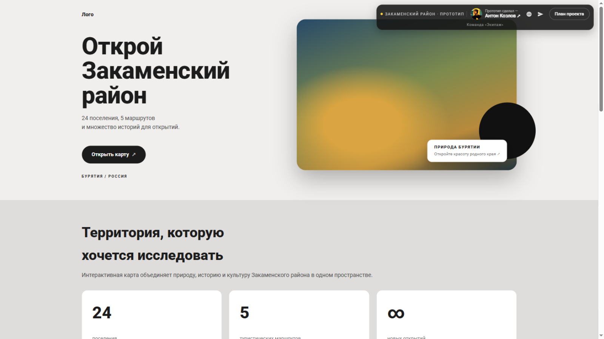
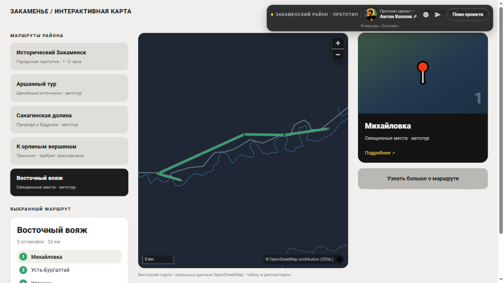
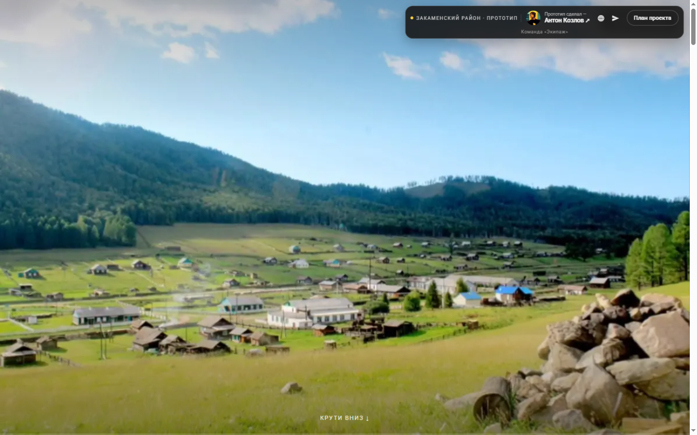

# Закаменье — интерактивная карта Закаменского района

> Грантовый проект **«От родного порога — к новым горизонтам»**
> 24 поселения · 5 маршрутов · 68 достопримечательностей · скролл-история района

**Демо:** [Vercel (основной)](https://zakamensk-map.vercel.app) · [GitHub Pages (резервный)](https://someguy3021.github.io/zakamenskmap-demo/)

## Скриншоты

| Лендинг | Интерактивная карта | Скролл-история |
|---|---|---|
|  |  |  |

## Что внутри

- **Лендинг** — витрина района: цифры, направления путешествий, анонс истории.
- **Скролл-история** — кадры с дрона, «перемотка» прокруткой: сцена проигрывается
  по мере скролла (canvas + GSAP ScrollTrigger), поверх всплывают подписи о местах.
- **Интерактивная карта** — векторная подоснова из данных OpenStreetMap
  (MapLibre GL JS + PMTiles: вся карта района в одном файле ~7 МБ), маршруты
  с профилем высот, карточки остановок, модуль «План проекта».

Вся логика работает в браузере, сервер не нужен: тайлы, шрифтовые глифы
и кадры сцен — статические файлы.

## Технологии

Vue 3 · Quasar · TypeScript · MapLibre GL JS · PMTiles · GSAP ScrollTrigger

## Данные и лицензии

- Векторная карта: © OpenStreetMap contributors — **ODbL**
- Факты о поселениях и объектах: Wikidata — **CC0**
- Атрибуция источников встроена в интерфейс карты

## Об этом репозитории

Репозиторий содержит **только сборку демо** для GitHub Pages (резервный хостинг).
Исходный код проекта — в приватном репозитории команды.

---

© 2026 Команда «Экипаж» · Антон Козлов
